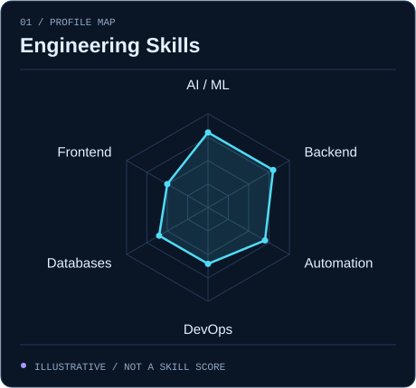
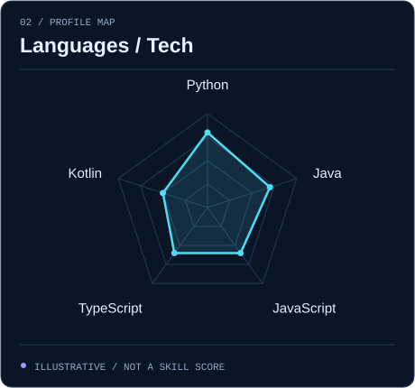

<a href="https://github.com/DarkOverlord689">
  <picture>
    <source media="(prefers-color-scheme: dark)" srcset="assets/banner-dark.svg">
    <source media="(prefers-color-scheme: light)" srcset="assets/banner-light.svg">
    
  </picture>
</a>

<picture>
  <source media="(prefers-color-scheme: dark)" srcset="assets/typing-dark.svg">
  <source media="(prefers-color-scheme: light)" srcset="assets/typing-light.svg">
  
</picture>

<h2 align="center"><code>$ whoami</code></h2>

  <picture>
    <source media="(prefers-color-scheme: dark)" srcset="assets/whoami-dark.svg">
    <source media="(prefers-color-scheme: light)" srcset="assets/whoami-light.svg">
    
  </picture>

<h2 align="center"><code>$ cat tech-stack.yaml</code></h2>

<table align="center">
  <tr>
    <td valign="top">
      <code>01</code>&nbsp; <b>Cloud &amp; DevOps</b>  
      <a href="https://aws.amazon.com/" title="AWS"><picture><source media="(prefers-color-scheme: dark)" srcset="assets/icons/cloud-dark.svg#aws"><source media="(prefers-color-scheme: light)" srcset="assets/icons/cloud-light.svg#aws"></picture></a>
      <a href="https://www.docker.com/" title="Docker"><picture><source media="(prefers-color-scheme: dark)" srcset="assets/icons/cloud-dark.svg#docker"><source media="(prefers-color-scheme: light)" srcset="assets/icons/cloud-light.svg#docker"></picture></a>
      <a href="https://kubernetes.io/" title="Kubernetes"><picture><source media="(prefers-color-scheme: dark)" srcset="assets/icons/cloud-dark.svg#kubernetes"><source media="(prefers-color-scheme: light)" srcset="assets/icons/cloud-light.svg#kubernetes"></picture></a>
      <a href="https://www.kernel.org/" title="Linux"><picture><source media="(prefers-color-scheme: dark)" srcset="assets/icons/cloud-dark.svg#linux"><source media="(prefers-color-scheme: light)" srcset="assets/icons/cloud-light.svg#linux"></picture></a> 
      AWS · Docker · Kubernetes · Linux
    </td>
    <td valign="top">
      <code>02</code>&nbsp; <b>AI / Machine Learning</b>  
      <a href="https://www.python.org/" title="Python"><picture><source media="(prefers-color-scheme: dark)" srcset="assets/icons/ai-dark.svg#python"><source media="(prefers-color-scheme: light)" srcset="assets/icons/ai-light.svg#python"></picture></a>
      <a href="https://pytorch.org/" title="PyTorch"><picture><source media="(prefers-color-scheme: dark)" srcset="assets/icons/ai-dark.svg#pytorch"><source media="(prefers-color-scheme: light)" srcset="assets/icons/ai-light.svg#pytorch"></picture></a>
      <a href="https://www.tensorflow.org/" title="TensorFlow"><picture><source media="(prefers-color-scheme: dark)" srcset="assets/icons/ai-dark.svg#tensorflow"><source media="(prefers-color-scheme: light)" srcset="assets/icons/ai-light.svg#tensorflow"></picture></a>
      <a href="https://opencv.org/" title="OpenCV"><picture><source media="(prefers-color-scheme: dark)" srcset="assets/icons/ai-dark.svg#opencv"><source media="(prefers-color-scheme: light)" srcset="assets/icons/ai-light.svg#opencv"></picture></a> 
      Python · PyTorch · TensorFlow · OpenCV
    </td>
  </tr>
  <tr>
    <td valign="top">
      <code>03</code>&nbsp; <b>Backend &amp; Frameworks</b>  
      <a href="https://fastapi.tiangolo.com/" title="FastAPI"><picture><source media="(prefers-color-scheme: dark)" srcset="assets/icons/backend-dark.svg#fastapi"><source media="(prefers-color-scheme: light)" srcset="assets/icons/backend-light.svg#fastapi"></picture></a>
      <a href="https://spring.io/" title="Spring"><picture><source media="(prefers-color-scheme: dark)" srcset="assets/icons/backend-dark.svg#spring"><source media="(prefers-color-scheme: light)" srcset="assets/icons/backend-light.svg#spring"></picture></a>
      <a href="https://nodejs.org/" title="Node.js"><picture><source media="(prefers-color-scheme: dark)" srcset="assets/icons/backend-dark.svg#nodejs"><source media="(prefers-color-scheme: light)" srcset="assets/icons/backend-light.svg#nodejs"></picture></a>
      <a href="https://dev.java/" title="Java"><picture><source media="(prefers-color-scheme: dark)" srcset="assets/icons/backend-dark.svg#java"><source media="(prefers-color-scheme: light)" srcset="assets/icons/backend-light.svg#java"></picture></a>
      <a href="https://kotlinlang.org/" title="Kotlin"><picture><source media="(prefers-color-scheme: dark)" srcset="assets/icons/backend-dark.svg#kotlin"><source media="(prefers-color-scheme: light)" srcset="assets/icons/backend-light.svg#kotlin"></picture></a> 
      FastAPI · Spring · Node.js · Java · Kotlin
    </td>
    <td valign="top">
      <code>04</code>&nbsp; <b>Databases</b>  
      <a href="https://www.postgresql.org/" title="PostgreSQL"><picture><source media="(prefers-color-scheme: dark)" srcset="assets/icons/databases-dark.svg#postgresql"><source media="(prefers-color-scheme: light)" srcset="assets/icons/databases-light.svg#postgresql"></picture></a>
      <a href="https://www.mysql.com/" title="MySQL"><picture><source media="(prefers-color-scheme: dark)" srcset="assets/icons/databases-dark.svg#mysql"><source media="(prefers-color-scheme: light)" srcset="assets/icons/databases-light.svg#mysql"></picture></a>
      <a href="https://www.mongodb.com/" title="MongoDB"><picture><source media="(prefers-color-scheme: dark)" srcset="assets/icons/databases-dark.svg#mongodb"><source media="(prefers-color-scheme: light)" srcset="assets/icons/databases-light.svg#mongodb"></picture></a>
      <a href="https://supabase.com/" title="Supabase"><picture><source media="(prefers-color-scheme: dark)" srcset="assets/icons/databases-dark.svg#supabase"><source media="(prefers-color-scheme: light)" srcset="assets/icons/databases-light.svg#supabase"></picture></a> 
      PostgreSQL · MySQL · MongoDB · Supabase
    </td>
  </tr>
  <tr>
    <td valign="top">
      <code>05</code>&nbsp; <b>Frontend</b>  
      <a href="https://react.dev/" title="React"><picture><source media="(prefers-color-scheme: dark)" srcset="assets/icons/frontend-dark.svg#react"><source media="(prefers-color-scheme: light)" srcset="assets/icons/frontend-light.svg#react"></picture></a>
      <a href="https://nextjs.org/" title="Next.js"><picture><source media="(prefers-color-scheme: dark)" srcset="assets/icons/frontend-dark.svg#nextjs"><source media="(prefers-color-scheme: light)" srcset="assets/icons/frontend-light.svg#nextjs"></picture></a>
      <a href="https://tailwindcss.com/" title="Tailwind CSS"><picture><source media="(prefers-color-scheme: dark)" srcset="assets/icons/frontend-dark.svg#tailwindcss"><source media="(prefers-color-scheme: light)" srcset="assets/icons/frontend-light.svg#tailwindcss"></picture></a>
      <a href="https://developer.mozilla.org/en-US/docs/Web/JavaScript" title="JavaScript"><picture><source media="(prefers-color-scheme: dark)" srcset="assets/icons/frontend-dark.svg#javascript"><source media="(prefers-color-scheme: light)" srcset="assets/icons/frontend-light.svg#javascript"></picture></a>
      <a href="https://www.typescriptlang.org/" title="TypeScript"><picture><source media="(prefers-color-scheme: dark)" srcset="assets/icons/frontend-dark.svg#typescript"><source media="(prefers-color-scheme: light)" srcset="assets/icons/frontend-light.svg#typescript"></picture></a> 
      React · Next.js · Tailwind CSS · JavaScript · TypeScript
    </td>
    <td valign="top">
      <code>06</code>&nbsp; <b>Tools &amp; Automation</b>  
      <a href="https://git-scm.com/" title="Git"><picture><source media="(prefers-color-scheme: dark)" srcset="assets/icons/tools-dark.svg#git"><source media="(prefers-color-scheme: light)" srcset="assets/icons/tools-light.svg#git"></picture></a>
      <a href="https://github.com/features/actions" title="GitHub Actions"><picture><source media="(prefers-color-scheme: dark)" srcset="assets/icons/tools-dark.svg#githubactions"><source media="(prefers-color-scheme: light)" srcset="assets/icons/tools-light.svg#githubactions"></picture></a> 
      Git · GitHub Actions
    </td>
  </tr>
</table>

<h2 align="center">AI &amp; Engineering</h2>

<table align="center">
  <tr>
    <td valign="top">
      <picture><source media="(prefers-color-scheme: dark)" srcset="assets/icons/symbols-dark.svg#generative"><source media="(prefers-color-scheme: light)" srcset="assets/icons/symbols-light.svg#generative"></picture> 
      <code>01</code>&nbsp; <b>Generative AI</b> 
      RAG Systems 
      LLM Integrations
    </td>
    <td valign="top">
      <picture><source media="(prefers-color-scheme: dark)" srcset="assets/icons/symbols-dark.svg#vision"><source media="(prefers-color-scheme: light)" srcset="assets/icons/symbols-light.svg#vision"></picture> 
      <code>02</code>&nbsp; <b>Computer Vision</b> 
      OCR &amp; Document Processing 
      Image &amp; document workflows
    </td>
  </tr>
  <tr>
    <td valign="top">
      <picture><source media="(prefers-color-scheme: dark)" srcset="assets/icons/symbols-dark.svg#backend"><source media="(prefers-color-scheme: light)" srcset="assets/icons/symbols-light.svg#backend"></picture> 
      <code>03</code>&nbsp; <b>Backend Systems</b> 
      Backend Architecture 
      Scalable systems
    </td>
    <td valign="top">
      <picture><source media="(prefers-color-scheme: dark)" srcset="assets/icons/symbols-dark.svg#cloud"><source media="(prefers-color-scheme: light)" srcset="assets/icons/symbols-light.svg#cloud"></picture> 
      <code>04</code>&nbsp; <b>Cloud / Automation</b> 
      Cloud Infrastructure 
      Intelligent automation
    </td>
  </tr>
</table>

<h2 align="center">Models</h2>

<table align="center">
  <thead>
    <tr>
      <th align="left">Family</th>
      <th align="left">Models</th>
    </tr>
  </thead>
  <tbody>
    <tr>
      <td valign="top"><picture><source media="(prefers-color-scheme: dark)" srcset="assets/icons/symbols-dark.svg#vision"><source media="(prefers-color-scheme: light)" srcset="assets/icons/symbols-light.svg#vision"></picture> <b>Vision</b> CNN architectures</td>
      <td>EfficientNetV2 · ResNet · MobileNet Inception · Xception</td>
    </tr>
    <tr>
      <td valign="top"><picture><source media="(prefers-color-scheme: dark)" srcset="assets/icons/symbols-dark.svg#attention"><source media="(prefers-color-scheme: light)" srcset="assets/icons/symbols-light.svg#attention"></picture> <b>Attention</b> Transformer family</td>
      <td>Transformers</td>
    </tr>
    <tr>
      <td valign="top"><picture><source media="(prefers-color-scheme: dark)" srcset="assets/icons/symbols-dark.svg#boosting"><source media="(prefers-color-scheme: light)" srcset="assets/icons/symbols-light.svg#boosting"></picture> <b>Boosting</b> Tree ensembles</td>
      <td>XGBoost</td>
    </tr>
  </tbody>
</table>

<h2 align="center"><code>$ visualize skills --radar</code></h2>

  <picture>
    <source media="(prefers-color-scheme: dark)" srcset="assets/radar-dark.svg">
    <source media="(prefers-color-scheme: light)" srcset="assets/radar-light.svg">
    
  </picture>
  <picture>
    <source media="(prefers-color-scheme: dark)" srcset="assets/radar-langs-dark.svg">
    <source media="(prefers-color-scheme: light)" srcset="assets/radar-langs-light.svg">
    
  </picture>

