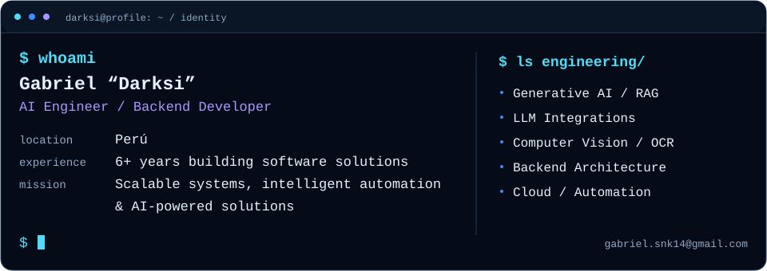
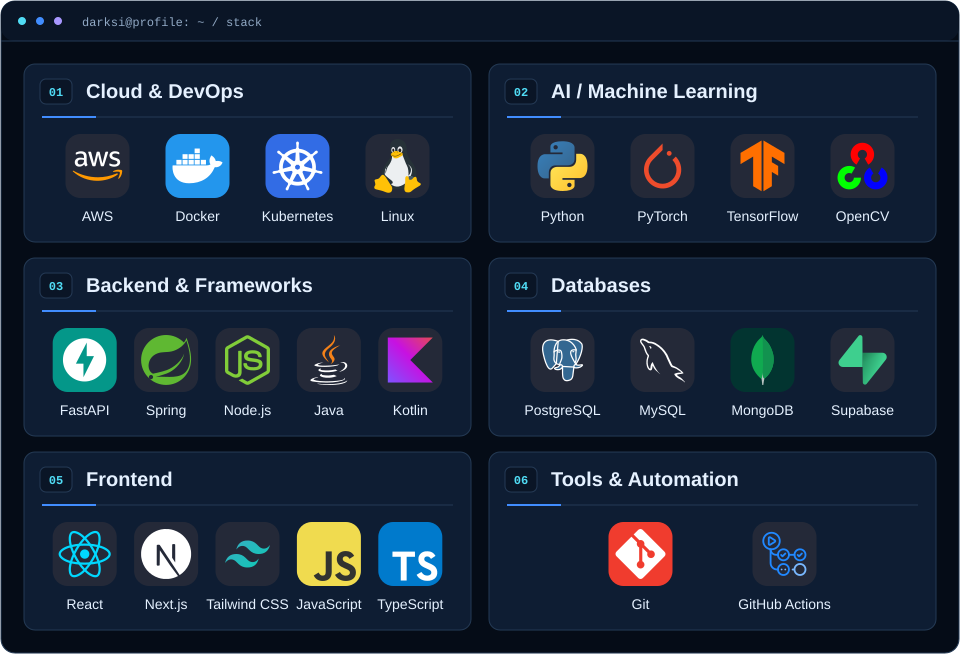
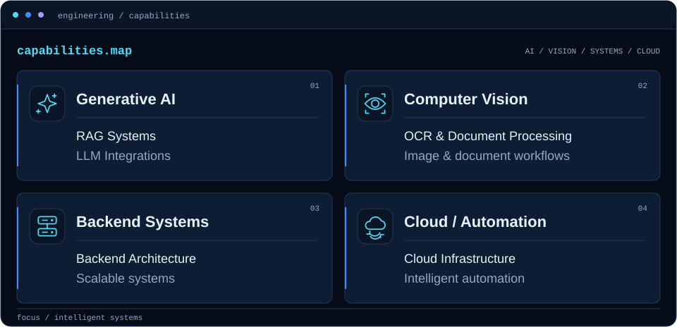
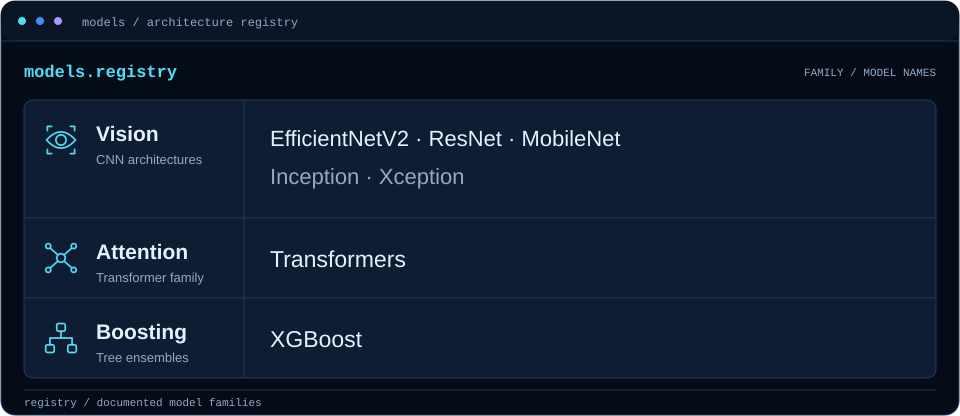

<a href="https://github.com/DarkOverlord689">
  <picture>
    <source media="(prefers-color-scheme: dark)" srcset="assets/banner-dark.svg">
    <source media="(prefers-color-scheme: light)" srcset="assets/banner-light.svg">
    
  </picture>
</a>

<picture>
  <source media="(prefers-color-scheme: dark)" srcset="assets/typing-dark.svg">
  <source media="(prefers-color-scheme: light)" srcset="assets/typing-light.svg">
  
</picture>

<h2 align="center"><code>$ whoami</code></h2>

  <picture>
    <source media="(prefers-color-scheme: dark)" srcset="assets/whoami-dark.svg">
    <source media="(prefers-color-scheme: light)" srcset="assets/whoami-light.svg">
    
  </picture>

<h2 align="center"><code>$ cat tech-stack.yaml</code></h2>

  <picture>
    <source media="(prefers-color-scheme: dark)" srcset="assets/tech-stack-dark.svg">
    <source media="(prefers-color-scheme: light)" srcset="assets/tech-stack-light.svg">
    
  </picture>

<h2 align="center">AI &amp; Engineering</h2>

  <picture>
    <source media="(prefers-color-scheme: dark)" srcset="assets/engineering-dark.svg">
    <source media="(prefers-color-scheme: light)" srcset="assets/engineering-light.svg">
    
  </picture>

<h2 align="center">Models</h2>

  <picture>
    <source media="(prefers-color-scheme: dark)" srcset="assets/models-dark.svg">
    <source media="(prefers-color-scheme: light)" srcset="assets/models-light.svg">
    
  </picture>

<h2 align="center"><code>$ visualize skills --radar</code></h2>

  <picture>
    <source media="(prefers-color-scheme: dark)" srcset="assets/radar-dark.svg">
    <source media="(prefers-color-scheme: light)" srcset="assets/radar-light.svg">
    
  </picture>
  <picture>
    <source media="(prefers-color-scheme: dark)" srcset="assets/radar-langs-dark.svg">
    <source media="(prefers-color-scheme: light)" srcset="assets/radar-langs-light.svg">
    
  </picture>

